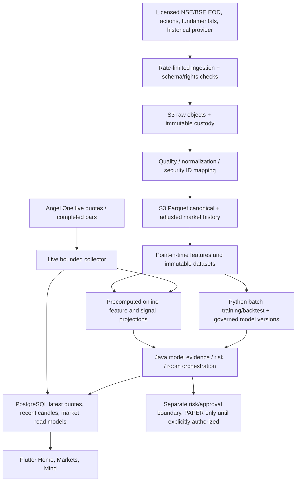

# RFC — Mintick Mind 20-year Indian market-data and model feature platform

**Status:** Proposed architecture, not an infrastructure deployment or a source-rights approval.
**Baseline:** `dev` on 2026-11-10, EC2 PAPER deployment, ap-south-1; MintTick app / Mintick Mind engine.
**Objective:** Up to 20–25 years of *licensed and available* NSE/BSE cash-market daily history per listing; initial focus on 20 years. Older data begins only at each security's actual listing date. Keep shorter, explicitly licensed intraday windows. Do not fabricate missing periods.

## 1. Architecture decision

Use four independently scalable paths, with strict ownership:

1. **Source ingestion and immutable custody (bronze)** — provider-native archival files and manifests in encrypted, versioned S3 **only if the source contract permits retention**. Store source/venue, acquisition time, exchange session, original file hashes, rights/license ID, permitted uses, and quarantine status. Never conflate a successful API request with commercial entitlements.
2. **Canonical and adjusted analytics (silver)** — validated OHLCV, time-varying security identity, corporate action factors, market session flags, sources, observed/available timestamps, and revisions as compact Parquet in S3. Start with versioned immutable manifests; introduce Glue + Iceberg snapshots if frequent amendments/concurrent writers justify complexity. Partition by exchange/frequency/date range (not one tiny object per stock); sort within files by stable listing ID and time, and compact.
3. **Point-in-time research + feature outputs (gold)** — separate materialized Parquet feature datasets with dataset manifests and hashes. Python runners load one immutable dataset snapshot for each experiment. Use Athena/DuckDB/Polars only in batch analytics, not on the interactive/order path. Maintain reproducible train/calibration/test splits and frozen universe memberships as of each historical date. Models share the same feature computation and independently declare their feature/schema versions.
4. **Hot serving and risk control** — existing Java/PostgreSQL/Cognito/SSM PAPER runtime remains operational authority. Use indexed recent candles, bounded read models, persisted last-good quotes, and *materialized* model features/signals, not S3 scans or Python training on each user request. Add Redis/ElastiCache only after measured p95/cache needs and cost review. Keep research workers separate from broker order access.

## 2. Existing implementation and concrete gaps

- **Current**: PostgreSQL `market_candle`, `candle_backfill_run`, `candle_backfill_checkpoint` (V8); existing 64-bar FIVE_MINUTE universe coverage (PR 698); checked active NSE/BSE cash catalogue 2,778 instruments on 2026-11-10; verified private one-session Angel One historical source read (PR 702); guarded collector still disabled unless explicitly opted in.
- **Gap**: The live database's unique key `(exchange, symbol_token, interval, candle_time)` is broker-token-scoped, not permanent security/listing identity. Do not reuse it for 20 years. Introduce `listing_id` (stable internal), temporal mappings to provider token and symbols, and source-specific aliases; ISIN supports identity reconciliation but is not by itself sufficient for all listing episodes/corporate transformations.
- **Gap**: The history service defaults to max 366 calendar days per request, with at most five provider chunks per call. SmartAPI ONE_DAY advertises an upper window of 2,000 days per request, but that is not 2,000 days of guaranteed historical availability. Create durable `dataset_backfill_job` and `dataset_backfill_chunk` by listing, interval, date and provider, rather than one 20-year synchronous endpoint.
- **Gap**: `GET /api/market-data/research/candles` currently caps export at 20,000 rows and pages PostgreSQL. This should remain a bounded interactive/export contract; 20-year bulk training must consume immutable S3 manifests, not millions of paginated JSON bars.
- **Gap**: `MarketDataRepository.recentCandles` is instrument-ID scoped while old catalogues rotate. Preserve lineage across ticker/token/catalogue versions in historical retrieval.
- **Gap**: Model roster dispatch supports 10 enrolled IDs, up to 4 parallel requests per case, budget 45 seconds, and is intentionally research-only. The ten-model throughput fixture reuses two trained synthetic families; it is not real production capacity/accuracy evidence.
- **Gap**: Current EC2 PAPER is a small single host with backend and PostgreSQL in Docker and an approximately 35-GiB root volume. It must not become the sole long-history lake, 20-year training machine, or production streaming backbone. The existing research ECS scaffold is dormant and refers to a different account/region (816344830716/us-east-1); do not apply it to the active 098859530205/ap-south-1 stack without a separately reviewed migration design.

## 3. Canonical data contracts

### Security identity
`security`: security_id, canonical issuer, applicable ISIN, lifecycle; `listing`: listing_id, security_id, NSE/BSE venue, valid_from, valid_to, listed/delisted/suspended, instrument category; `provider_symbol_alias`: provider, exchange, symbol/token, listing_id, valid_from/to, observed_at; temporal uniqueness constraints. Security reincorporation/merger/spin-off is explicit lineage, never silent alias overwrite.

### Raw bars and revisions
`bar` fields: listing_id, venue, interval, session_date, bar_time_utc, open/high/low/close/volume, currency, provider/source_id, source_event_at, provider_published_at, first_available_at, ingested_at, revision_id, quality_flags, immutable_batch_id, rights_policy_id. Store raw first; validate calendar, OHLC, duplicate, timestamp, timezone, exchange action, stale source and missing sessions. Preserve earlier revisions with as-of visibility.

### Corporate actions
Actions: split, bonus, dividend, merger/demerger, rights, ticker change, capital changes and delisting; action_id, effective/ex date, announced_at, source, adjustment_factor, data_revision, rights. Produce separate **raw**, **split-adjusted**, and **total-return** views with defined reinvestment conventions. Never retroactively apply corporate actions that were unknown at historical decision time.

### Research datasets
`dataset_manifest`: id, version, interval, date partition list, source fingerprints, schema version, code commit, price adjustment mode, listing-universe snapshot, label availability, feature cutoff, license allowlist, checksums, row count, verified gap coverage, manifest SHA-256. `experiment` binds manifest digest + fold/fee/target/model hashes. Reuse existing model registry, V56–V62 custody and point-in-time feature guards rather than creating a second governance system.

## 4. Retrieval: never load 20 years per live decision

| Consumer | Read path | Suggested initial benchmark target (not existing SLA) |
|---|---|---|
| Home/Market quotes | application feed → latest-good PostgreSQL view; cache after load testing | warm read p95 < 250 ms |
| Single-stock charts | precomputed daily/weekly/monthly tiles or recent indexed candle window; cursor-based pages | warm p95 < 350 ms |
| Research scan | nightly/daily materialized features and latest N completed bars | batch, backpressure |
| Multiple online model decisions | one typed feature snapshot per (listing_id, as_of, schema_version), fan-out to permitted roster; never recompute across models | instrument and roster p95 measured separately |
| 20-year backtests | S3 Parquet column/partition pruning via batch worker; frozen manifest and point-in-time universe | throughput/budget benchmark, not request-path SLA |
| Training/retraining | scheduled isolated Python job reading frozen dataset snapshot | asynchronous; no trading critical path |

Keep hot paths online after market hours by serving the last verified snapshot with explicit exchange time, source, freshness and market-closed state. Avoid representing stale data as live. Model responses, if enabled, must be validated against data cutoff, model version, confidence/evidence and deterministic risk policy. The UI must not cause provider re-login or arbitrary historical fetch.

## 5. Backfill algorithm and capacity

- Target daily 2006–2026/25-year extension, **from actual listing date**. At 2,778 currently eligible listings × roughly 252 sessions/year × 20 years ≈ **14 million daily OHLCV observations** under the simplifying assumption that every one of today's 2,778 listings existed for the full 20 years. Many started later and would have fewer rows; delisted/historical listings add rows. This is a scale illustration, not a complete historical inventory. A year of 5-minute bars for 2,778 listings would be roughly 52 million observations (75 session bars × 252 days), so don't retain 20-year intraday on the tiny EC2 disk.
- Source adapter supports licensed bulk EOD provider/exchange files, plus bounded broker historical queries where permitted. Never assume Angel One supports 20-year entitlement or history merely because five-minute one-session smoke succeeded.
- Coordinator creates idempotent jobs keyed by (source, listing_id, frequency, date_window, data_revision). Dedicated finite-worker queue, durable leases, max attempts, exponential+jitter retry, global provider throttle/circuit breaker, and dead letter inspection; checkpoint each validated chunk before advancing.
- Verify source continuity against actual trade sessions and listing episodes; distinguishing holiday, suspended/not-listed, no-trade, source outage and corrupted data. Quarantine conflicting provider revisions instead of silently updating old backtests. Publish Parquet/manifest atomically only after content hash, counts and gap policy pass.
- Start with **S3 + existing Postgres metadata + one controlled worker**; introduce SQS for decoupling retries and ECS/Fargate batch CPU as data volume increases. Keep concurrency under vendor quotas, schedule off peak, and cost-cap all experimental AWS resources.
- Do not mark a listing `COMPLETE` because one segment returned HTTP 200 or zero bars. Coverage denominator is expected listed trading sessions per listing/interval. Separate 20-year DAILY completeness from 64-bar FIVE_MINUTE strategy readiness.

## 6. Security, licensing and point-in-time validation

- For NSE data, acquisition, retention, internal analytics, app display and redistribution may require **different explicitly permitted uses**. Production processing stops on unverified rights; SSM secrets never leave private source adapters; per-source IAM/Lake Formation access policies and encryption.
- Existing Java governance + real brokerage risk/approval remain the only capital boundary; no model/feature-store/Lake query can place orders. Research workers have read-only dataset access and no broker-order credentials.
- Point-in-time security universe must include delisted, failed, renamed, transferred companies and *historical* index memberships and fundamentals to prevent survivorship/lookahead bias.
- Store `event_time`, `published_at`, `available_at`, `ingested_at` separately. Forecast features may use only data available at decision time; training labels remain future-only and outside live inputs.
- Keep manifest history immutable and reversible. Preserve audit lineage even if source rights require removal of raw copies. Enforce trading calendar + corporate actions + data freshness, quality confidence and human-reviewed exception queues.

## 7. Sequenced PR implementation plan (all from latest dev; no parallel conflicting writes)

**D20-01 — Contracts and storage decisions:** Add typed listing/alias/corporate-action/dataset-manifest/rights/coverage contracts and no-op feature flags; synthetic fixtures and migration tests; no infrastructure.
**D20-02 — Safe migration/identity:** Forward-only Flyway tables with index/constraint, mapping from V48 to stable listing IDs; historical aliases + delisted fixtures; leave current candle routes unchanged.
**D20-03 — Dataset ingest coordinator:** Broker-independent `HistoricalDatasetProvider`, finite scheduling + global provider backoff + idempotent chunk leases and source-rights gating; test only with licensed fixture. No automatic 20-year calls.
**D20-04 — S3 raw/curated storage:** Encrypted prefix/IAM/multi-part Parquet compactor, manifest checksums, catalogue/partition layout and recovery tests; explicit ap-south-1 cost/permissions approval before provision.
**D20-05 — Daily history:** Import a single permitted daily symbol and period, measure listing-day completeness and verify corporate-action raw/adjusted dual views; progressively expand only on approved data source.
**D20-06 — Feature materialization:** Deterministic batch feature definitions reused across models, immutable offline Parquet + hot read projections, as-of test matrix, provenance and backfill invalidation.
**D20-07 — Fast serving:** Chart downsampling/tiles, cursor pagination, last-good cache and materialized multi-model feature read; realistic latency soak under concurrent market traffic, fallback to PostgreSQL initially.
**D20-08 — Research integration:** Wire the existing Java/Python source contract to immutable S3 data manifests and genuine listing-time universe snapshots, retrain model challengers on frozen folds, report p95 throughput and costs.
**D20-09 — Rollout:** 1 symbol → 50 → 500 → full eligible historical universe, daily sessions and delisted coverage, idempotent recovery tests, non-live shadow soak. Only then consider production read scalability.

## 8. Required release gates

- External historical source agreement explicitly covers 20-year availability, permitted internal research/training, persistence/derived data, end-user display and redistribution as applicable.
- No full-universe downloads, ingestion workers, new paid AWS resources or LIVE order permissions through this architecture-only RFC.
- Source completeness report shows per year: eligible historical listings, expected/actual sessions, validated bars, corporate-action resolution, provider lag/holes, adjusted-vs-raw lineage, and dataset hash.
- Performance evidence from real licensed datasets must measure separate p50/p95/p99 for cache serving, chart retrieval, batch ingest, feature refresh, model fan-out and worker replays; never claim synthetic CI timings are live SLAs.
- Account and region must be `098859530205 / ap-south-1` for new MintTick resources, not the older research scaffold account/region.
- Every PR checks the latest remote `dev` before merge to preserve concurrent Mintick Mind and Markets fixes.
